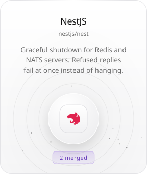
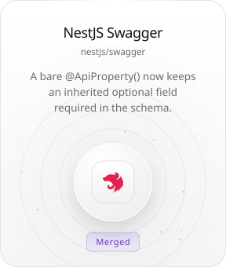
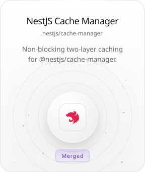
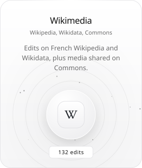

<picture><source media="(prefers-color-scheme: dark)" srcset="https://cdn.jsdelivr.net/gh/samuelmbabhazi/samuelmbabhazi@56dc3afdac8eb1ad1ca422fe823fed49c82cb75c/assets/dark/hero.svg"></picture>

  

<picture><source media="(prefers-color-scheme: dark)" srcset="https://cdn.jsdelivr.net/gh/samuelmbabhazi/samuelmbabhazi@56dc3afdac8eb1ad1ca422fe823fed49c82cb75c/assets/dark/sec-upstream.svg"></picture>

<a href="https://github.com/mozilla-firefox/firefox/commit/7493f8317675"><picture><source media="(prefers-color-scheme: dark)" srcset="https://cdn.jsdelivr.net/gh/samuelmbabhazi/samuelmbabhazi@56dc3afdac8eb1ad1ca422fe823fed49c82cb75c/assets/dark/card-firefox.svg"></picture></a> <a href="https://github.com/Automattic/mongoose/pulls?q=is%3Apr+author%3Asamuelmbabhazi"><picture><source media="(prefers-color-scheme: dark)" srcset="https://cdn.jsdelivr.net/gh/samuelmbabhazi/samuelmbabhazi@56dc3afdac8eb1ad1ca422fe823fed49c82cb75c/assets/dark/card-mongoose.svg"></picture></a> <a href="https://github.com/nestjs/nest/pull/17671"><picture><source media="(prefers-color-scheme: dark)" srcset="./assets/dark/card-nestcore.svg"></picture></a> <a href="https://github.com/nestjs/swagger/pull/4226"><picture><source media="(prefers-color-scheme: dark)" srcset="./assets/dark/card-nestswagger.svg"></picture></a>
<a href="https://github.com/nestjs/cache-manager/pull/962"><picture><source media="(prefers-color-scheme: dark)" srcset="./assets/dark/card-nestcache.svg"></picture></a> <a href="https://github.com/typeorm/typeorm/pulls?q=is%3Apr+author%3Asamuelmbabhazi+is%3Amerged"><picture><source media="(prefers-color-scheme: dark)" srcset="https://cdn.jsdelivr.net/gh/samuelmbabhazi/samuelmbabhazi@56dc3afdac8eb1ad1ca422fe823fed49c82cb75c/assets/dark/card-typeorm.svg"></picture></a> <a href="https://github.com/WordPress/sqlite-database-integration/pull/500"><picture><source media="(prefers-color-scheme: dark)" srcset="https://cdn.jsdelivr.net/gh/samuelmbabhazi/samuelmbabhazi@56dc3afdac8eb1ad1ca422fe823fed49c82cb75c/assets/dark/card-wordpress.svg"></picture></a> <a href="https://github.com/Automattic/studio/pull/4797"><picture><source media="(prefers-color-scheme: dark)" srcset="https://cdn.jsdelivr.net/gh/samuelmbabhazi/samuelmbabhazi@56dc3afdac8eb1ad1ca422fe823fed49c82cb75c/assets/dark/card-studio.svg"></picture></a>
<a href="https://github.com/ever-co/ever-gauzy/pulls?q=is%3Apr+author%3Asamuelmbabhazi+is%3Amerged"><picture><source media="(prefers-color-scheme: dark)" srcset="https://cdn.jsdelivr.net/gh/samuelmbabhazi/samuelmbabhazi@56dc3afdac8eb1ad1ca422fe823fed49c82cb75c/assets/dark/card-gauzy.svg"></picture></a> <a href="https://github.com/abhigyanpatwari/GitNexus/pulls?q=is%3Apr+author%3Asamuelmbabhazi+is%3Amerged"><picture><source media="(prefers-color-scheme: dark)" srcset="https://cdn.jsdelivr.net/gh/samuelmbabhazi/samuelmbabhazi@56dc3afdac8eb1ad1ca422fe823fed49c82cb75c/assets/dark/card-gitnexus.svg"></picture></a> <a href="https://github.com/WikiEducationFoundation/WikiEduDashboard/pulls?q=is%3Apr+author%3Asamuelmbabhazi+is%3Amerged"><picture><source media="(prefers-color-scheme: dark)" srcset="https://cdn.jsdelivr.net/gh/samuelmbabhazi/samuelmbabhazi@56dc3afdac8eb1ad1ca422fe823fed49c82cb75c/assets/dark/card-wikiedu.svg"></picture></a> <a href="https://github.com/MODSetter/SurfSense/pull/2267"><picture><source media="(prefers-color-scheme: dark)" srcset="https://cdn.jsdelivr.net/gh/samuelmbabhazi/samuelmbabhazi@56dc3afdac8eb1ad1ca422fe823fed49c82cb75c/assets/dark/card-surfsense.svg"></picture></a>
<a href="https://github.com/xerj-org/xerj/pulls?q=is%3Apr+author%3Asamuelmbabhazi+is%3Amerged"><picture><source media="(prefers-color-scheme: dark)" srcset="https://cdn.jsdelivr.net/gh/samuelmbabhazi/samuelmbabhazi@56dc3afdac8eb1ad1ca422fe823fed49c82cb75c/assets/dark/card-xerj.svg"></picture></a> <a href="https://gitlab.com/wikisuite/wikisuite-script-for-wikisuite-package/-/merge_requests?scope=all&state=merged&author_username=samuelmbabhazi"><picture><source media="(prefers-color-scheme: dark)" srcset="https://cdn.jsdelivr.net/gh/samuelmbabhazi/samuelmbabhazi@56dc3afdac8eb1ad1ca422fe823fed49c82cb75c/assets/dark/card-wikisuite.svg"></picture></a> <a href="https://github.com/ever-co/ever-traduora/pulls?q=is%3Apr+author%3Asamuelmbabhazi+is%3Amerged"><picture><source media="(prefers-color-scheme: dark)" srcset="https://cdn.jsdelivr.net/gh/samuelmbabhazi/samuelmbabhazi@56dc3afdac8eb1ad1ca422fe823fed49c82cb75c/assets/dark/card-traduora.svg"></picture></a> <a href="https://github.com/ever-co/ever-teams/pulls?q=is%3Apr+author%3Asamuelmbabhazi+is%3Amerged"><picture><source media="(prefers-color-scheme: dark)" srcset="https://cdn.jsdelivr.net/gh/samuelmbabhazi/samuelmbabhazi@56dc3afdac8eb1ad1ca422fe823fed49c82cb75c/assets/dark/card-teams.svg"></picture></a>
<a href="https://meta.wikimedia.org/wiki/Special:CentralAuth/Samuel_mbabhazi"><picture><source media="(prefers-color-scheme: dark)" srcset="./assets/dark/card-wikimedia.svg"></picture></a>

  

<picture><source media="(prefers-color-scheme: dark)" srcset="https://cdn.jsdelivr.net/gh/samuelmbabhazi/samuelmbabhazi@56dc3afdac8eb1ad1ca422fe823fed49c82cb75c/assets/dark/sec-practice.svg"></picture>

<picture><source media="(prefers-color-scheme: dark)" srcset="https://cdn.jsdelivr.net/gh/samuelmbabhazi/samuelmbabhazi@56dc3afdac8eb1ad1ca422fe823fed49c82cb75c/assets/dark/practice.svg"></picture>

  

<picture><source media="(prefers-color-scheme: dark)" srcset="https://cdn.jsdelivr.net/gh/samuelmbabhazi/samuelmbabhazi@56dc3afdac8eb1ad1ca422fe823fed49c82cb75c/assets/dark/sec-toolkit.svg"></picture>

<picture><source media="(prefers-color-scheme: dark)" srcset="https://cdn.jsdelivr.net/gh/samuelmbabhazi/samuelmbabhazi@56dc3afdac8eb1ad1ca422fe823fed49c82cb75c/assets/dark/toolkit.svg"></picture>

  

<picture><source media="(prefers-color-scheme: dark)" srcset="https://cdn.jsdelivr.net/gh/samuelmbabhazi/samuelmbabhazi@56dc3afdac8eb1ad1ca422fe823fed49c82cb75c/assets/dark/sec-activity.svg"></picture>

<picture><source media="(prefers-color-scheme: dark)" srcset="https://cdn.jsdelivr.net/gh/samuelmbabhazi/samuelmbabhazi@main/assets/dark/stats.svg"></picture>

  

<picture><source media="(prefers-color-scheme: dark)" srcset="https://cdn.jsdelivr.net/gh/samuelmbabhazi/samuelmbabhazi@56dc3afdac8eb1ad1ca422fe823fed49c82cb75c/assets/dark/sec-contact.svg"></picture>

<a href="https://samuelmbabhazi.me"><picture><source media="(prefers-color-scheme: dark)" srcset="https://cdn.jsdelivr.net/gh/samuelmbabhazi/samuelmbabhazi@56dc3afdac8eb1ad1ca422fe823fed49c82cb75c/assets/dark/link-portfolio.svg"></picture></a>&nbsp;<a href="https://github.com/samuelmbabhazi"><picture><source media="(prefers-color-scheme: dark)" srcset="https://cdn.jsdelivr.net/gh/samuelmbabhazi/samuelmbabhazi@56dc3afdac8eb1ad1ca422fe823fed49c82cb75c/assets/dark/link-github.svg"></picture></a>&nbsp;<a href="https://linkedin.com/in/samuelmbabhazi"><picture><source media="(prefers-color-scheme: dark)" srcset="https://cdn.jsdelivr.net/gh/samuelmbabhazi/samuelmbabhazi@56dc3afdac8eb1ad1ca422fe823fed49c82cb75c/assets/dark/link-linkedin.svg"></picture></a>&nbsp;<a href="mailto:samuelmbabhazi@gmail.com"><picture><source media="(prefers-color-scheme: dark)" srcset="https://cdn.jsdelivr.net/gh/samuelmbabhazi/samuelmbabhazi@56dc3afdac8eb1ad1ca422fe823fed49c82cb75c/assets/dark/link-email.svg"></picture></a>&nbsp;<a href="https://www.upwork.com/freelancers/~013636cfc522b0d380"><picture><source media="(prefers-color-scheme: dark)" srcset="https://cdn.jsdelivr.net/gh/samuelmbabhazi/samuelmbabhazi@56dc3afdac8eb1ad1ca422fe823fed49c82cb75c/assets/dark/link-upwork.svg"></picture></a>&nbsp;<a href="https://dev.to/samuelmbabhazi"><picture><source media="(prefers-color-scheme: dark)" srcset="https://cdn.jsdelivr.net/gh/samuelmbabhazi/samuelmbabhazi@56dc3afdac8eb1ad1ca422fe823fed49c82cb75c/assets/dark/link-devto.svg"></picture></a>

